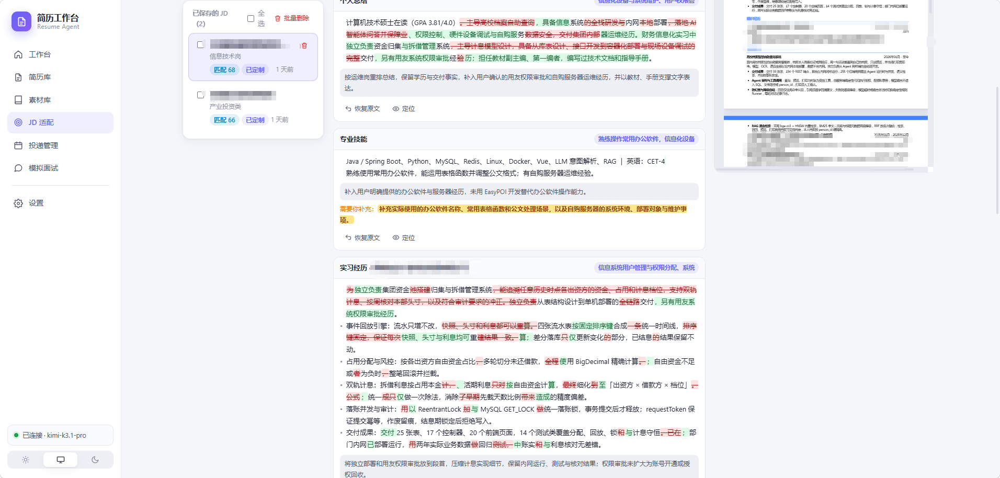
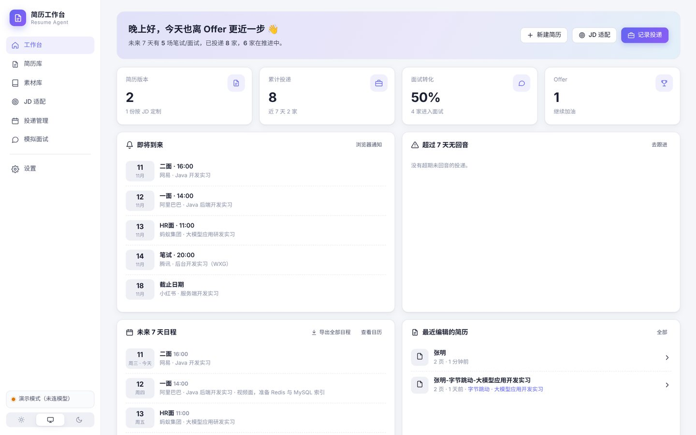
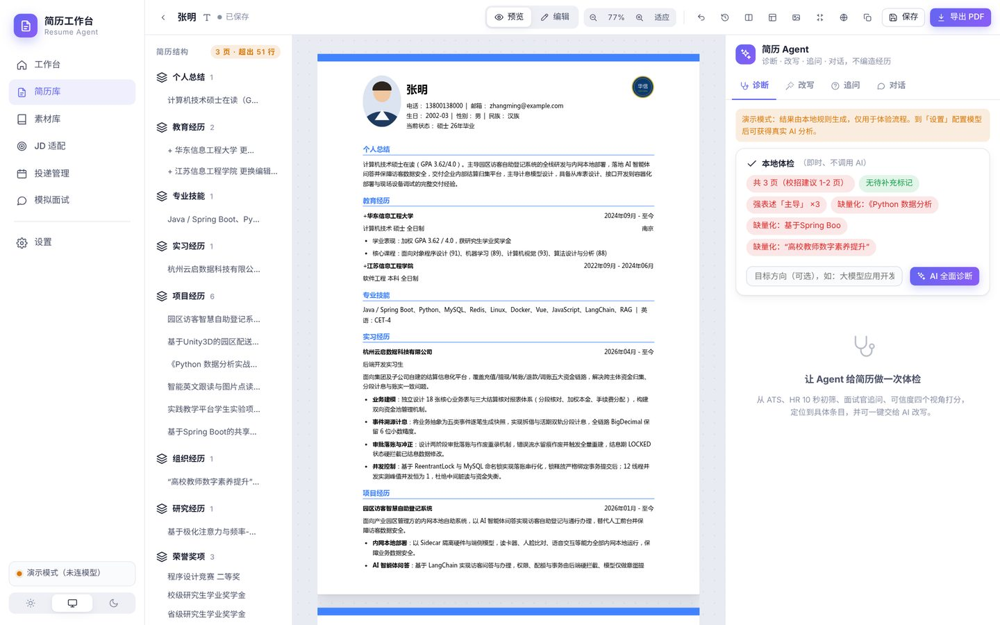
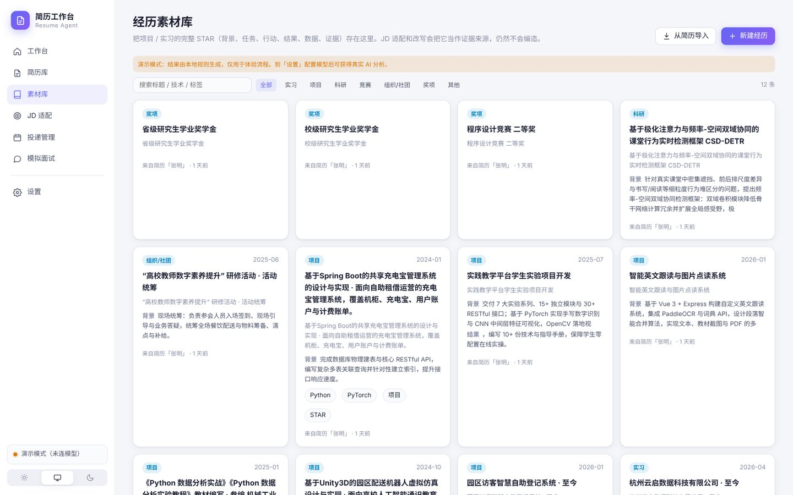
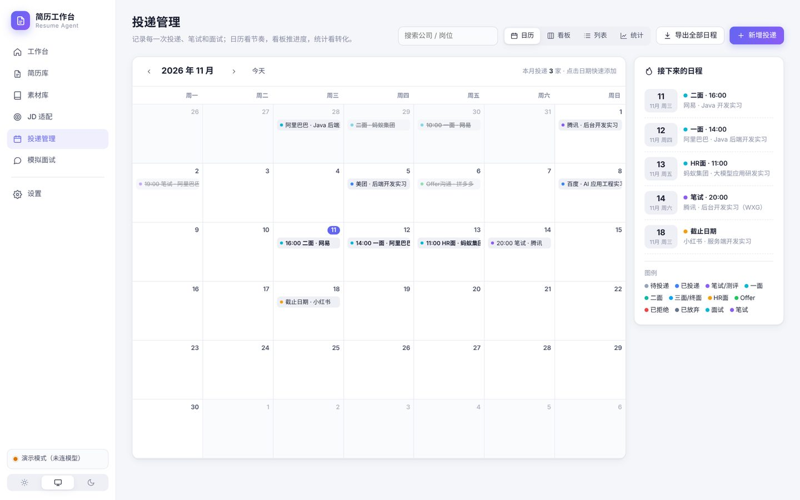
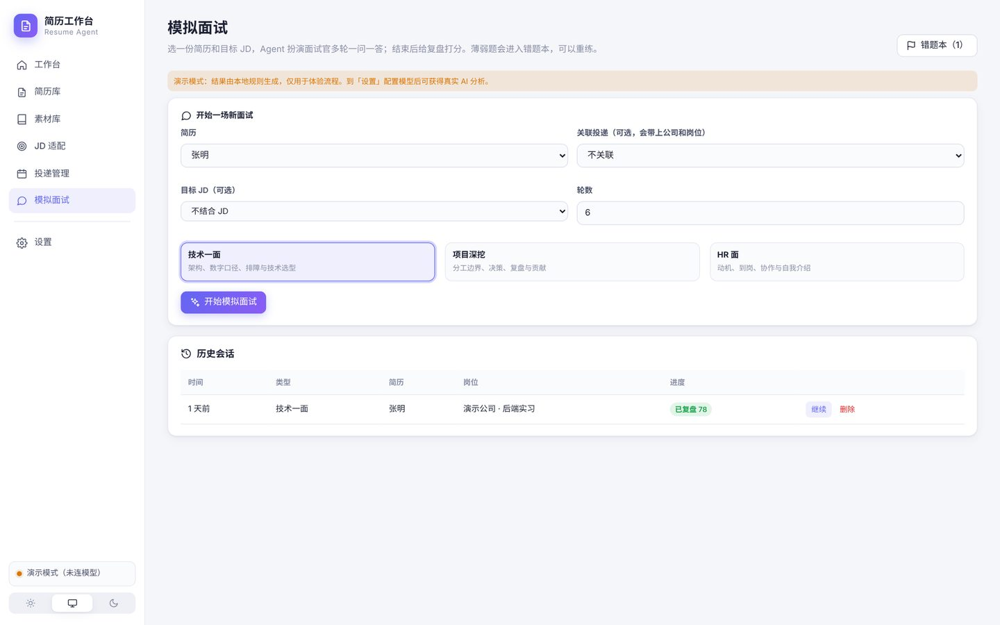

# 简历工作台

> 根据 JD 定制简历的本地工具：粘贴岗位描述，生成一份逐条可对比、可恢复的定制版简历，不编造经历。

[](https://nodejs.org/)
[](#快速开始)
[](#license)

## 根据 JD 定制简历



1. **粘贴 JD**：贴岗位原文或链接，自动解析公司、岗位、硬性要求和加分项。
2. **匹配分析**：给出匹配度和分项得分，并列出岗位条件对照表（每条要求对应的简历证据和覆盖程度），以及优势、关键缺口和「不宜牵强写入」的条目。
3. **生成定制版**：基于原简历复制出一份新简历，只改与岗位相关的表述和顺序；可以补充真实信息，或从素材库挑经历一起给模型参考。
4. **逐条对比**：每处修改都显示和原文的差异（删除标红划线，新增标绿），附带修改理由和对应的 JD 要求；可以逐条「恢复原文」或重新应用，点「定位」跳到预览里的位置。
5. **不编造**：缺少事实依据的地方会标出「需要你补充」，不会自己写数字；JD 要求但简历里找不到证据的项目，单独列出且不写进简历。
6. **后续**：定制版可直接在编辑器打开、导出 PDF、关联投递记录，还能生成 Boss 直聘开场白和针对这份 JD 的面试追问。

## 其他功能

| | |
| --- | --- |
| **首页**：近期笔试面试提醒、简历和投递概览 |  |
| **编辑器**：A4 原样预览、就地编辑、左侧填报卡片、本地体检与 AI 诊断 / 分模块改写，七套模板一键切换 |  |
| **素材库**：按情境、任务、行动、结果整理完整经历，作为改写和定制时的事实依据；可「从本机项目生成」，指定项目目录后自动扫描 README、依赖、代码规模和 Git 提交，起草一条素材 |  |
| **投递日历**：笔试 / 面试日程、看板拖动改状态、导出 `.ics` |  |
| **模拟面试**：技术面 / 项目深挖 / HR 面多轮追问，错题可重练 |  |

### 从本机项目或一段话生成经历素材

在素材库点「从项目或描述生成」，有两种方式：

- **本机项目**：填项目目录的绝对路径（可选填自己的角色说明和 Git 作者）。Agent 先看程序生成的概览（目录树、依赖清单、代码规模、提交统计），再**自己决定读哪些文件**：查看目录、分段读文件、正则搜索、看提交记录。每一步都会实时显示，比如「读取 src/server.js」「搜索 app.get」。全程只读，最多 20 次工具调用，工具输出累计不超过 8 万字符，总时长 4 分钟，用完就开始写草稿。如果模型接口不支持工具调用，会自动改用固定扫描。勾选「只用固定扫描」就按旧方式先预览要发送的全部内容。
- **用一段话描述**：用自己的话写做了什么、负责哪部分、用了什么技术、结果如何，Agent 只用你写到的事实整理成素材。

规则：
- 工具只能访问项目目录内的文件，`../`、绝对路径和指向外部的符号链接一律拒绝。`node_modules`、`.git`、构建产物、二进制不读；`.env*`、`*.pem`、`*.key`、`id_rsa*`、`credentials*`、`*secret*` 等密钥类文件拒绝读取。所有工具输出在发给模型前都会把疑似 API Key、令牌和密码替换成「已隐藏」。
- 草稿里的数字只来自程序统计或你的描述，依据只能引用实际读过的文件。用户规模、性能、上线情况、个人分工等无法证明的内容会标【待补充】并列成问题，保存后用「Agent 引导式深挖」补齐。

数据全部保存在本机，服务默认只监听 `127.0.0.1`；不需要 `npm install`，导出 PDF 使用本机 Chrome / Edge。

## 下载

不想装 Node 的话，到仓库的 Releases 页面（或 Actions 的构建产物）下载对应平台的压缩包：`windows-x64`、`macos-arm64`、`macos-x64`、`linux-x64`。解压后双击（或在终端运行）`resume-platform`，会自动启动服务并打开浏览器。更新时直接用新版本替换整个程序文件夹即可，数据不受影响（见下方「数据保存在哪」）。macOS 首次打开若被拦截，在「系统设置 → 隐私与安全性」里允许即可。

自己打包：`npm run build:exe`（需要 Node 22 以上并联网），产物在 `dist/`。

## 数据保存在哪

程序和数据分开存放，程序文件夹里只有程序本身（含入门模板 `starter/` 和示例数据 `examples/`）。简历、历史版本、素材库、JD、投递、面试、导出文件、设置与 API Key 都在数据目录里：

| 系统 | 数据目录 |
| --- | --- |
| Windows | `%APPDATA%\jd-resume` |
| macOS | `~/Library/Application Support/jd-resume` |
| Linux | `$XDG_DATA_HOME/jd-resume`，默认 `~/.local/share/jd-resume` |

- 第一次启动会放一份「我的简历」入门模板，各模块都有占位文字，照着替换即可；删掉后不会再出现，新建简历时仍可选「从入门模板创建」。素材库、JD、投递、面试一开始都是空的。
- 想先看看完整效果：设置 → 「导入示例数据」，导入虚构候选人的简历、JD、投递和面试记录（同名跳过，不覆盖已有数据）。
- 设置 → 「删除所有用户数据」会清空数据目录（需两次确认），恢复到第一次启动的状态。
- 环境变量 `RESUME_HOME` 可以把数据放到任意目录（比如同步盘）。
- 旧版（4.7 及以前）把数据放在程序目录的 `resumes/`、`data/` 里；程序目录里已有简历或配置时会继续沿用那里，不用迁移。想改用系统目录，把这两个文件夹移过去即可。设置页「本地环境」会显示当前用的数据目录。

## 快速开始

```bash
git clone https://github.com/httpdone/jd-resume
cd jd-resume
npm start          # 即 node cli.mjs serve，自动打开 http://127.0.0.1:4321/
```

Node 18 以上，Windows / macOS / Linux 用法相同。换端口或不自动打开浏览器：`node cli.mjs serve --port 5000 --no-open`。

没有 API Key 也可以先开「演示模式」把流程走一遍（结果带演示标记）。

## 模型配置

- 在「设置」里选预设（DeepSeek / 通义千问 / Kimi / 智谱 / 豆包 / 硅基流动 / OpenAI / OpenRouter / Ollama / 自定义），填 Base URL 和 API Key，可一键获取模型列表并测试连接。支持任何 OpenAI 兼容的 `/chat/completions` 接口。
- **Key 按供应商分开保存**：切换预设不会串用别家的 Key；自定义接口按 Base URL 区分。Key 存在数据目录的 `data/config.json`，界面只显示打码结果，请求由本机后端代理发出。
- **结构化输出**：诊断、改写、JD 分析和定制等任务优先用 JSON Schema 约束输出；供应商不支持时自动退到 JSON 模式，再不行才用提示词约束加自动修复，并记住每个模型可用的方式。
- **最大输出 Token** 默认 32768（推理模型需要较大的额度）；接口提示超出上限时会自动降到 8192 重试。
- 也可以用环境变量 `LLM_API_KEY`、`LLM_BASE_URL`、`LLM_MODEL` 配置。

更多说明见 [docs/USAGE.md](docs/USAGE.md)。

## 与同类工具对比

下表只描述能力边界，便于选型，不评价其他项目的质量。

|  | 本项目（简历工作台） | 在线简历网站 | 通用对话模型（直接聊天改简历） | 开源岗位对照 / 改写脚本 |
| --- | --- | --- | --- | --- |
| 运行位置 | 本机，默认仅 localhost | 云端账号与服务器 | 取决于该模型的服务商 | 多为本地脚本或另一套服务 |
| 安装 | Node 18，零 npm 依赖 | 打开网站即可 | 打开网站即可 | 通常要按各自说明安装 |
| 模板与 PDF | 7 套 A4 主题，本机 Chrome 导出 | 模板多、在线导出 | 一般不负责排版和 PDF | 多数不内置完整排版 |
| 岗位适配 | 解析 JD、证据对照、一键出定制版 | 部分产品提供优化建议 | 可以改写，但流程和写回要自己管 | 往往聚焦对照或改写单步 |
| 经历约束 | 提示词与写回规则限制「不编造」 | 因产品而异 | 需自己反复叮嘱，易写出无依据内容 | 部分项目也强调证据，能力范围不同 |
| 投递与面试 | 日历 / 看板 / 提醒 / 模拟面试 | 部分有投递记录 | 一般没有 | 一般没有完整投递模块 |
| 数据与 Key | 文件在本机，Key 经后端代理 | 数据在服务商 | Key 或对话内容在服务商 | 因项目而异 |

如果你主要需要海量模板或在线协作，在线简历网站可能更合适；如果只是偶尔让模型改一段文字，通用对话即可。本项目面向「希望数据留在自己电脑上、并且按诊断 → 对照 JD → 投递 → 面试这一套流程工作」的同学。

## 项目结构

```
cli.mjs                  命令入口（serve / list / new / edit / pdf / html / rm）
lib/server.mjs           网页版后端：静态文件、REST API、SSE Agent
lib/templates.mjs        模板目录与主题排版
lib/media.mjs            头像 / 校徽存储与素材库
lib/project-scan.mjs     本机项目扫描（素材库「从项目或描述生成」）
lib/agent/explore.mjs    Agent 自主阅读项目（只读工具调用）
lib/models.mjs           经后端代理获取模型列表
lib/agent/               提示词、JSON Schema、模型调用、演示模式
lib/apps.mjs             投递记录与 JD
lib/store.mjs            简历存储、历史版本、重命名
public/                  前端（原生 ES Module，无构建）
template/  assets/       经典蓝模板样式与 themes.css（不含字体文件）
docs/                    使用说明、原创性对照报告、宣传截图
starter/                 入门模板「我的简历」（首次启动复制到数据目录）
examples/                示例简历与数据（设置 →「导入示例数据」）
数据目录/resumes/<名称>/  body.html、meta.json、assets/、.history/
数据目录/data/            投递、JD、素材、面试、素材库、配置（含 Key）
数据目录/out/             导出的 HTML / PDF
tests/                   冒烟测试、假模型服务、截图脚本
tools/build-sea.mjs      打包单文件可执行程序（.github/workflows/build.yml 调用）
```

## 字体

项目不附带任何字体文件，只引用系统已安装的字体：中文依次尝试 PingFang SC、Microsoft YaHei、Noto Sans CJK SC、思源黑体、Hiragino Sans GB，最后回退到系统无衬线字体。导出 PDF 同样使用这些系统字体。

## 致谢与参考

下列仓库的**流程思路**（先诊断再改写、对照岗位条件再动笔、不编造事实等）对产品设计有启发。提示词与界面文案已用自己的话重写，并做了命名和维度上的差异化；**没有复制**无许可证仓库中的文字。许可见「致谢」是为了如实说明思路来源，不代表沿用其原文。对照细节见 [docs/originality-report.md](docs/originality-report.md)。

| 项目 | 许可 | 我们吸收的思路（非原文） |
| --- | --- | --- |
| [wanyichen06/LLMInternSkill](https://github.com/wanyichen06/LLMInternSkill) | MIT（Copyright © 2026 couragec） | 先把问题说清楚再改措辞、依据不足时改用更稳妥的说法、按观察面组织面试追问 |
| [coinluu/resume-jd-optimizer-cn](https://github.com/coinluu/resume-jd-optimizer-cn) | MIT（Copyright © 2026 coinluu） | 解析岗位条件并区分权重、对照表后再改写、贡献语气不可加重、缺数据用占位标记 |
| [Elowwwen/resume-evidence-workflow](https://github.com/Elowwwen/resume-evidence-workflow) | MIT（Copyright © 2026 Resume Evidence Workflow contributors） | 先对照岗位条件与材料再改写、不擅自删除经历、只改正文不改 HTML 外壳 |
| [gaoweiblue-source/resume-expert](https://github.com/gaoweiblue-source/resume-expert) | **未附 LICENSE**（默认保留所有权利） | 仅参考分步输出、改写对照、面试准备等常见产品形态；未复制其提示词或文案 |
| [wangyafu/resume-skills](https://github.com/wangyafu/resume-skills) | **未附 LICENSE**（默认保留所有权利） | 仅参考情境—行动—结果、适度加粗、一页篇幅等行业常见建议；未复制其提示词或文案 |

STAR、ATS 关键词、不编造经历等属于行业通用做法，不算对某一仓库的抄袭。

## License

[MIT](LICENSE) © 2026

示例数据（`examples/` 里的「张明」等）为虚构示例。

## 社区

有问题、建议，或想一起折腾？欢迎来 **[linux.do](https://linux.do)** 社区交流反馈。
